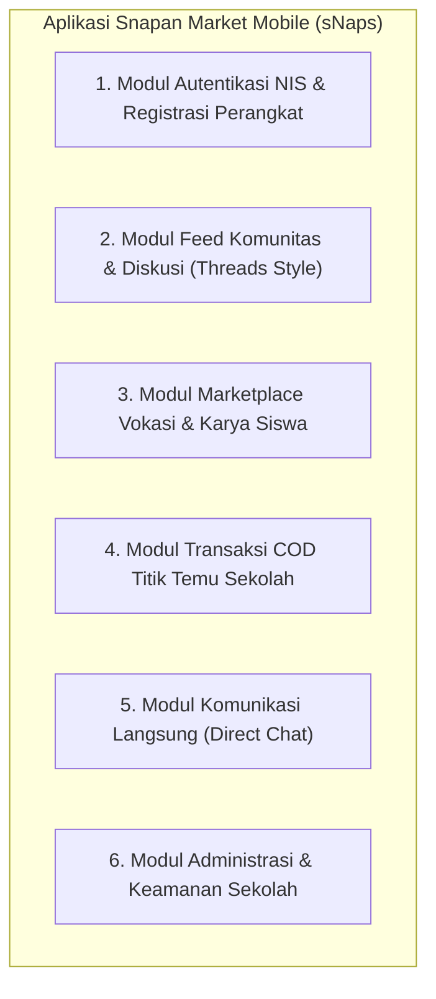

# 00. SINGLE SOURCE OF TRUTH (SSOT) & RUANG LINGKUP SISTEM
**Proyek**: Snapan Market Mobile (sNaps) - Ekosistem Digital SMKN 8 Semarang  
**Dokumen**: Panduan Acuan Baku Perancangan Sistem (BAB III)  

---

## 📌 1. Apa itu SSOT dalam Pengerjaan Bab III Ini?

**SSOT (Single Source of Truth)** adalah **satu dokumen acuan mutlak** yang disepakati bersama oleh seluruh anggota kelompok sebelum mulai menggambar diagram apa pun.

### Mengapa SSOT Sangat Penting?
Tanpa SSOT, pengerjaan tugas kelompok rawan konflik fatal:
1. **Ketidaksinkronan Aktor**: Anggota 1 menulis aktor *"Kasir"*, Anggota 2 menulis *"Siswa"*, Anggota 3 menulis *"User"*.
2. **Ketidaksinkronan Database**: Anggota DFD membuat tabel bernama `barang`, sedangkan pembuat ERD menamakannya `products`, dan pembuat Class Diagram menamakannya `ItemPost`.
3. **Penyimpangan Fitur**: Salah satu anggota malah memasukkan fitur scan barcode kasir toko kelontong, padahal model bisnis aplikasi adalah marketplace C2C berbasis titik temu COD sekolah.

> **Aturan Wajib Kelompok**: Seluruh diagram (Flowchart, DFD, Use Case, Activity, ERD, CDM, PDM, Class, dan Sequence) **WAJIB** merujuk pada nama aktor, nama entitas, dan batasan alur yang tertulis di dokumen SSOT ini.

---

## 👥 2. Aktor Resmi Sistem

| Nama Aktor Resmi | Peran & Hak Akses di sNaps |
|---|---|
| **Siswa (Warga Sekolah)** | Pengguna terdaftar melalui verifikasi NIS. Memiliki peran ganda C2C (*Peer-to-Peer*): dapat berbelanja produk vokasi, menjual karya/preloved, membuat thread komunitas di feed, berpartisipasi polling, mengirim direct message, dan memesan produk via COD titik temu sekolah. |
| **Admin Sekolah** | Pengelola sistem dari pihak sekolah. Memiliki wewenang mengimpor/mengelola master registry siswa (NIS & Kelas), memverifikasi laporan konten/postingan melanggar (*content moderation*), mengelola titik temu COD (*school meeting points*), dan memantau log keamanan perangkat. |

---

## 📦 3. Ruang Lingkup Modul & Fitur Utama

### Rincian Modul:
1. **Modul Autentikasi**:
   - Validasi NIS terhadap buku induk sekolah (`student_registry`).
   - Pendaftaran akun dengan username, password, dan bind hardware perangkat (`device_registrations`).
2. **Modul Feed Komunitas**:
   - Publikasi thread diskusi antar jurusan (PPLG, DKV, Kuliner, dll).
   - Interaksi sosial: polling interaktif, komentar bersarang, dan likes.
3. **Modul Marketplace Vokasi**:
   - Pembuatan listing produk barang fisik, karya digital, atau perlengkapan sekolah preloved.
   - Manajemen informasi stok, harga, deskripsi, dan foto galeri produk.
4. **Modul Transaksi COD Sekolah**:
   - Pembelian langsung tanpa perantara payment gateway luar (*zero transaction fee*).
   - Penentuan Titik Temu COD Resmi (Gazebo Utama, Kantin Pusat, Bengkel PPLG, dsb).
   - Catatan pembeli untuk penjual dan pelacakan status pesanan.
5. **Modul Direct Chat**:
   - Obrolan privat langsung antara calon pembeli dan penjual untuk negosiasi atau konfirmasi janji temu.
6. **Modul Administrasi**:
   - Dashboard kurasi data master siswa, pemblokiran akun bermasalah, dan peninjauan laporan konten.

---

## 🗄️ 4. Kamus Data & Entitas Baku (Supabase / PostgreSQL)

Berikut adalah daftar nama tabel resmi yang digunakan sebagai rujukan ERD, CDM, PDM, dan DFD:

| Nama Entitas / Tabel | Fungsi Utama | Kunci Utama (PK) | Relasi Kunci (FK) |
|---|---|---|---|
| `student_registry` | Database induk siswa SMKN 8 Semarang | `nis` (TEXT) | Master Data Sekolah |
| `profiles` | Data akun pengguna aktif aplikasi sNaps | `id` (UUID) | Terikat ke `auth.users` & `student_registry(nis)` |
| `market_posts` | Postingan feed dan listing produk vokasi | `id` (UUID) | `seller_id` -> `profiles(id)` |
| `school_meeting_points` | Master lokasi titik temu COD di area sekolah | `id` (UUID) | Lokasi referensi transaksi |
| `orders` | Transaksi pesanan COD antar siswa | `id` (UUID) | `buyer_id`, `seller_id`, `post_id`, `meeting_point_id` |
| `conversations` | Wadah ruang obrolan antar 2 pengguna | `id` (UUID) | `buyer_id`, `seller_id`, `post_id` |
| `direct_messages` | Pesan teks individual di dalam percakapan | `id` (UUID) | `conversation_id`, `sender_id` |
| `content_reports` | Laporan pelanggaran konten oleh siswa | `id` (UUID) | `reporter_id`, `post_id` |

---

## 🤝 5. Matriks Konsistensi Antar Diagram

| Dokumen | Yang Harus Selaras dengan SSOT |
|---|---|
| **Flowchart** | Tidak ada kasir toko; alur adalah Siswa Pembeli memesan karya Siswa Penjual dengan COD di titik sekolah. |
| **Diagram Konteks** | Sistem sNaps di tengah; hanya ada 2 entitas luar: **Siswa** dan **Admin Sekolah**. |
| **DFD Level 0** | Sub-proses 1.0 Autentikasi NIS, 2.0 Feed Komunitas, 3.0 Marketplace Karya, 4.0 Transaksi COD, 5.0 Moderasi Admin. |
| **Use Case** | Use case dikelompokkan ke aktor Siswa dan Admin Sekolah. |
| **Activity** | Alur activity berfokus pada checkout COD dan pemilihan titik temu sekolah. |
| **ERD / CDM / PDM** | Menggunakan 8 tabel baku di atas dengan tipe data PostgreSQL modern (UUID, TEXT, INT, TIMESTAMPTZ). |
| **Class Diagram** | Struktur class memetakan model Dart di `lib/features/` dengan controller dan service Supabase. |
| **Sequence Diagram** | Pesan interaksi antar objek: Auth (Siswa -> LoginController -> SupabaseAuth -> RegistryDB) dan Checkout (Siswa -> CheckoutController -> OrderService -> Database). |
