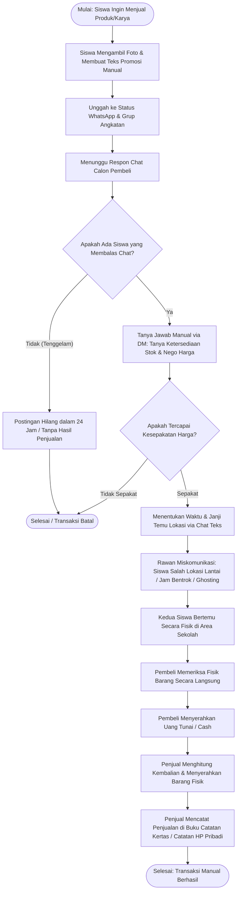

# 02. DIAGRAM FLOWCHART ALUR MANUAL (KONVENSIONAL)

**Dokumen**: Bab III - Bagian 3.2.1  
**Proyek**: Snapan Market Mobile (sNaps) - SMKN 8 Semarang  
**Fokus**: Pemetaan Alur Transaksi Konvensional Siswa Sebelum Menggunakan Sistem Digital  

---

## 1. Definisi & Ruang Lingkup Alur Manual
Alur manual merupakan representasi langkah-langkah kerja yang saat ini dilakukan oleh warga sekolah di SMKN 8 Semarang saat melakukan transaksi jual-beli produk karya vokasi, preloved, maupun makanan ringan secara konvensional melalui grup chat WhatsApp dan transaksi fisik tatap muka.

---

## 2. Diagram Flowchart Manual

---

## 3. Penjelasan Simbol Flowchart yang Digunakan

| Simbol | Nama Simbol | Keterangan Fungsi dalam Diagram |
|---|---|---|
| ⬭ | **Terminator (`[Mulai/Selesai]`)** | Menandai titik awal inisiasi transaksi oleh siswa dan titik akhir selesainya proses. |
| ▭ | **Process (`Proses`)** | Menggambarkan tindakan operasional manusia, seperti memotret karya, menulis status WhatsApp, dan menghitung uang tunai. |
| ◇ | **Decision (`Keputusan`)** | Titik percabangan logika kondisi yang menghasilkan pilihan "Ya" atau "Tidak" (cth: ada respon chat atau tidak). |
| ➔ | **Flowline (`Garis Alir`)** | Menunjukkan arah urutan langkah proses dari atas ke bawah. |

---

## 4. Analisis Masalah & Titik Kritis Alur Manual

1. **Titik Lemah Pencatatan Stok (No Stock Visibility)**:
   Penjual harus merespon chat satu per satu hanya untuk mengabarkan bahwa barang sudah habis terjual, menghabiskan waktu produktif jam sekolah.
2. **Friksi Janji Temu (Meeting Uncertainty)**:
   Pesan teks seperti *"Nanti ketemuan di dekat tangga ya"* sering memicu kebingungan karena SMKN 8 Semarang memiliki banyak gedung dan lantai tangga, sehingga rawan gagal bertemu.
3. **Ketiadaan Bukti Transaksi Resmi**:
   Tidak ada nota digital atau tanda terima transaksi yang mengikat kedua belah pihak, menyulitkan penyelesaian sengketa bila barang yang diserahkan tidak sesuai perjanjian awal.
