# 03. DIAGRAM FLOWCHART SISTEM DIGITAL (sNAPS)

**Dokumen**: Bab III - Bagian 3.2.2  
**Proyek**: Snapan Market Mobile (sNaps) - SMKN 8 Semarang  
**Fokus**: Pemetaan Logika Terotomatisasi Platform Mobile sNaps  

---

## 1. Definisi & Konsep Alur Sistem Digital
Alur sistem digital memodelkan bagaimana instruksi komputasi berjalan di aplikasi mobile sNaps, mulai dari validasi akun berbasis NIS, pemilihan katalog karya, pemilihan titik temu sekolah (*School Meeting Points*), pengecekan stok atomik di database PostgreSQL Supabase, hingga penerbitan bukti pesanan digital.

---

## 2. Diagram Flowchart Sistem

```mermaid
flowchart TD
    Start([Mulai: Siswa Membuka Aplikasi sNaps]) --> CheckAuth{Apakah Token Sesi Login Aktif?}
    CheckAuth -- Tidak --> InputNIS[Input NIS & Password Siswa]
    InputNIS --> ValidateRegistry[(Validasi ke Tabel student_registry)]
    ValidateRegistry --> CheckNISValid{Apakah NIS Terdaftar & Aktif?}
    CheckNISValid -- Tidak --> ShowAlertAuth[Tampilkan Peringatan: 'NIS Tidak Terdaftar di SMKN 8'] --> InputNIS
    CheckNISValid -- Ya --> CreateSession[Terbitkan Sesi JWT & Muat Profil Siswa]
    
    CheckAuth -- Ya --> LoadHome[Buka Layar Beranda: Feed Komunitas & Marketplace]
    CreateSession --> LoadHome

    LoadHome --> UserNavChoice{Pilih Aktivitas Siswa}

    %% JALUR PENJUAL
    UserNavChoice -- Jual Produk / Unjuk Karya --> OpenCreatePost[Buka Formulir Pembuatan Listing Produk]
    OpenCreatePost --> FillProductData[Input Judul, Deskripsi, Kategori Jurusan, Foto, Harga, Stok]
    FillProductData --> ValidateInput{Validasi Input Lengkap?}
    ValidateInput -- Tidak --> ShowErrorForm[Tampilkan Pesan Error Validasi Form] --> FillProductData
    ValidateInput -- Ya --> InsertProductDB[(Simpan Record Baru ke Tabel market_posts)]
    InsertProductDB --> PostBroadcast[Produk Tayang Secara Publik di Feed] --> EndSellerWait([Selesai: Menunggu Pembeli])

    %% JALUR PEMBELI
    UserNavChoice -- Beli Produk Vokasi --> BrowseMarket[Jelajah Katalog & Filter Kategori: PPLG / DKV / Kuliner]
    BrowseMarket --> OpenDetail[Buka Halaman Detail Produk & Profil Penjual]
    OpenDetail --> CheckAvailableStock{Cek Database: Apakah Stok > 0?}
    CheckAvailableStock -- Habis (0) --> ShowEmptyState[Tombol Beli Dinonaktifkan: 'Stok Habis'] --> BrowseMarket
    CheckAvailableStock -- Tersedia --> TapBuy[Tekan Tombol 'Beli Sekarang']
    
    TapBuy --> OpenCheckoutSheet[Sistem Membuka Lembar Checkout COD]
    OpenCheckoutSheet --> LoadMeetingPoints[(Query Lokasi Aktif dari school_meeting_points)]
    LoadMeetingPoints --> SelectPoint[Pembeli Memilih Titik Temu: Gazebo / Kantin / Lab]
    SelectPoint --> InputBuyerNote[Pembeli Menulis Catatan Jam COD Istirahat]
    InputBuyerNote --> TapConfirmOrder[Tekan 'Konfirmasi Pesanan']

    TapConfirmOrder --> AtomicTxBegin[(Mulai Transaksi Database Atomik)]
    AtomicTxBegin --> LockStockRow{Kunci Baris & Validasi Stok Akhir}
    LockStockRow -- Stok Habis Dibeli Siswa Lain --> RollbackTx[Batalkan Transaksi & Tampilkan Alert] --> BrowseMarket
    LockStockRow -- Stok Valid --> InsertOrder[(Insert ke Tabel orders: Status PENDING)]
    InsertOrder --> DeductStockDB[(Update: Kurangi Kuantitas Stok di market_posts)]
    DeductStockDB --> AtomicTxCommit[(Commit Transaksi Database)]

    AtomicTxCommit --> TriggerPushNotif[Kirim Push Notification Masuk ke HP Siswa Penjual]
    TriggerPushNotif --> GenerateDigitalReceipt[Terbitkan Bukti Pesanan Digital dengan Kode Transaksi Unik]
    GenerateDigitalReceipt --> ShowSuccessModal[Tampilkan Modal Sukses Checkout ke Pembeli]
    
    ShowSuccessModal --> MeetPhysicalCOD[Kedua Siswa Bertemu di Titik Temu Sekolah Sesuai Catatan]
    MeetPhysicalCOD --> CompleteVerification[Pembeli Memeriksa Barang & Membayar Tunai]
    CompleteVerification --> TapOrderDone[Siswa Menekan 'Pesanan Selesai' di Aplikasi]
    TapOrderDone --> UpdateOrderStatusDB[(Update Status Pesanan: COMPLETED di Tabel orders)]
    UpdateOrderStatusDB --> EndFinish([Selesai: Transaksi Berhasil])
```

---

## 3. Penjelasan Tahapan Krusial Sistem

1. **Validasi NIS Dua Lapis (Two-Tier Auth)**:
   Aplikasi memeriksa nomor induk ke `student_registry` sekolah sebelum menghubungkan ke data akun `profiles`.
2. **Kalkulasi & Pengecekan Stok Atomik (*Concurrency-Safe*)**:
   Sistem tidak mengizinkan dua pembeli memesan produk yang tersisa 1 buah secara bersamaan; transaksi database menerapkan penguncian baris (*row-level lock*) untuk mencegah data ganda.
3. **Standarisasi Lokasi Titik Temu (*School Meeting Points*)**:
   Sistem tidak menggunakan input teks bebas untuk lokasi, melainkan *dropdown master data* titik kumpul resmi yang terpetakan dengan jelas di lingkungan SMKN 8 Semarang.
4. **Penerbitan Bukti Digital Instan**:
   Setelah konfirmasi, nota digital otomatis tersimpan di riwayat transaksi kedua belah pihak sebagai tanda pengikat pesanan sah.
