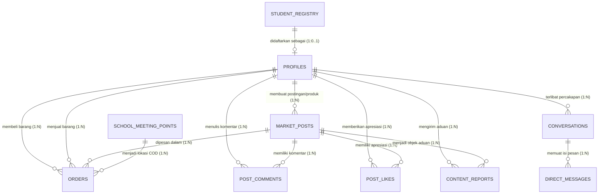

# 06. ENTITY RELATIONSHIP DIAGRAM (ERD)

**Dokumen**: Bab III - Bagian 3.6  
**Proyek**: Snapan Market Mobile (sNaps) - SMKN 8 Semarang  
**Fokus**: Pemetaan Hubungan Logis & Kardinalitas Entitas Relasional  

---

## 1. Definisi & Konsep ERD
Entity Relationship Diagram (ERD) menggambarkan struktur keterhubungan logis antar kumpulan entitas data di dalam sistem sNaps, menentukan bagaimana data siswa, produk vokasi, pesanan COD, dan titik temu sekolah saling berelasi dengan derajat kardinalitas referensial.

---

## 2. Diagram ERD Relasional sNaps

---

## 3. Kamus Entitas & Analisis Derajat Kardinalitas

### 3.1 Relasi `STUDENT_REGISTRY` ke `PROFILES` (One-to-Optional-One / `1:0..1`)
- **Partisipasi**: Setiap satu baris NIS pada `STUDENT_REGISTRY` hanya boleh didaftarkan ke maksimal **satu** akun pengguna di `PROFILES`. Siswa yang belum mendaftar aplikasi berstatus `0` akun aktif.
- **Integritas**: Menjamin asas *One Student, One Account* di lingkungan SMKN 8 Semarang untuk mencegah akun ganda (*kloningan*).

### 3.2 Relasi `PROFILES` ke `MARKET_POSTS` (One-to-Many / `1:N`)
- **Partisipasi**: Satu profil siswa dapat mempublikasikan banyak produk karya vokasi maupun thread diskusi komunitas.
- **Kunci Asing**: Kolom `seller_id` pada `MARKET_POSTS` merujuk ke `id` pada tabel `PROFILES`.

### 3.3 Relasi `PROFILES` (Buyer & Seller) ke `ORDERS` (One-to-Many / `1:N`)
- **Partisipasi**: Satu siswa dapat menjadi pembeli pada banyak pesanan (`buyer_id`) dan sekaligus menjadi penjual pada banyak pesanan lain (`seller_id`).
- **Model Bisnis**: Mengadopsi arsitektur C2C (*Peer-to-Peer*) terpadu di mana siswa tidak perlu berganti akun untuk bertindak sebagai penjual atau pembeli.

### 3.4 Relasi `MARKET_POSTS` ke `ORDERS` (One-to-Many / `1:N`)
- **Partisipasi**: Satu jenis produk karya siswa dapat dipesan berkali-kali oleh pembeli yang berbeda selama sisa stok produk masih mencukupi.

### 3.5 Relasi `SCHOOL_MEETING_POINTS` ke `ORDERS` (One-to-Many / `1:N`)
- **Partisipasi**: Satu titik temu resmi sekolah (contoh: *Gazebo Depan PPLG*) dapat menjadi lokasi pertemuan transaksi COD untuk banyak pesanan siswa.

### 3.6 Relasi `CONVERSATIONS` ke `DIRECT_MESSAGES` (One-to-Many / `1:N`)
- **Partisipasi**: Satu ruang obrolan transaksi memuat banyak pesan teks riwayat percakapan antara pembeli dan penjual.

---

## 4. Tabel Aturan Integritas Referensial (*Referential Actions*)

| Relasi Parent ➔ Child | Foreign Key | On Delete Rule | On Update Rule | Alasan Desain Sistem |
|---|---|---|---|---|
| `PROFILES` ➔ `MARKET_POSTS` | `seller_id` | `CASCADE` / Soft Delete | `CASCADE` | Jika profil dinonaktifkan permanen, listing ikut dinonaktifkan. |
| `PROFILES` ➔ `ORDERS` | `buyer_id` / `seller_id` | `RESTRICT` | `CASCADE` | Riwayat pesanan tidak boleh terhapus demi transparansi audit transaksi. |
| `SCHOOL_MEETING_POINTS` ➔ `ORDERS` | `meeting_point_id` | `RESTRICT` | `CASCADE` | Titik kumpul yang pernah dipakai COD tidak boleh terhapus dari riwayat pesanan. |
| `CONVERSATIONS` ➔ `DIRECT_MESSAGES` | `conversation_id` | `CASCADE` | `CASCADE` | Jika obrolan dihapus kedua pihak, seluruh pesan pesan ikut terhapus. |
