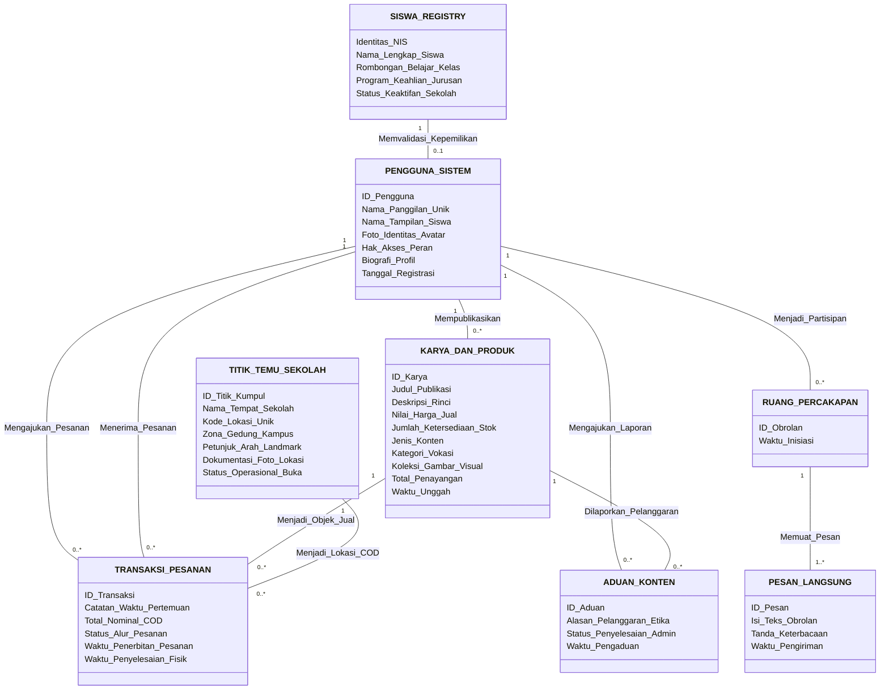

# 07. CONCEPTUAL DATA MODEL (CDM)

**Dokumen**: Bab III - Bagian 3.7.1  
**Proyek**: Snapan Market Mobile (sNaps) - SMKN 8 Semarang  
**Fokus**: Pemodelan Objek Bisnis Logis Independen terhadap Teknologi Database Fisik  

---

## 1. Definisi & Tujuan CDM
Conceptual Data Model (CDM) adalah pemodelan data tingkat konseptual yang mendefinisikan entitas bisnis dasar, atribut esensial, dan hubungan semantik antar objek secara independen dari perangkat keras, perangkat lunak sistem operasi, maupun spesifikasi vendor *Database Management System* (DBMS).

---

## 2. Diagram Konseptual Logis (CDM)

---

## 3. Rincian Objek Bisnis Logis

### 3.1 Entitas Bisnis `SISWA_REGISTRY`
- **Konsep Bisnis**: Representasi buku induk resmi kesiswaan SMKN 8 Semarang.
- **Atribut Logis**: `Identitas_NIS` (Kunci Unik Bisnis), `Nama_Lengkap_Siswa`, `Rombongan_Belajar_Kelas` (cth: XII PPLG 1), `Program_Keahlian_Jurusan` (PPLG, DKV, Kuliner), `Status_Keaktifan_Sekolah`.

### 3.2 Entitas Bisnis `PENGGUNA_SISTEM`
- **Konsep Bisnis**: Representasi subjek pengguna aktif aplikasi mobile sNaps.
- **Atribut Logis**: `ID_Pengguna`, `Nama_Panggilan_Unik`, `Nama_Tampilan_Siswa`, `Hak_Akses_Peran` (*Siswa* atau *Admin Sekolah*), `Biografi_Profil`.

### 3.3 Entitas Bisnis `KARYA_DAN_PRODUK`
- **Konsep Bisnis**: Komoditas digital atau fisik yang diciptakan siswa untuk dipamerkan atau diperjualbelikan.
- **Atribut Logis**: `ID_Karya`, `Judul_Publikasi`, `Deskripsi_Rinci`, `Nilai_Harga_Jual`, `Jumlah_Ketersediaan_Stok`, `Jenis_Konten` (*Karya Thread* atau *Produk Vokasi*), `Kategori_Vokasi`.

### 3.4 Entitas Bisnis `TITIK_TEMU_SEKOLAH`
- **Konsep Bisnis**: Landmark fisik di dalam area SMKN 8 Semarang yang disepakati sebagai lokasi aman transaksi COD.
- **Atribut Logis**: `ID_Titik_Kumpul`, `Nama_Tempat_Sekolah` (*Gazebo PPLG, Kantin Timur, Depan Bengkel Otomotif*), `Zona_Gedung_Kampus`.

### 3.5 Entitas Bisnis `TRANSAKSI_PESANAN`
- **Konsep Bisnis**: Kontrak kesepakatan transaksi COD antara dua siswa di sekolah.
- **Atribut Logis**: `ID_Transaksi`, `Catatan_Waktu_Pertemuan`, `Total_Nominal_COD`, `Status_Alur_Pesanan` (*Menunggu, Diterima, Selesai, Dibatalkan*).

---

## 4. Keunggulan Desain Konseptual
Struktur CDM ini sepenuhnya independen terhadap teknologi database. Jika sekolah di masa mendatang ingin memindahkan penyimpanan dari PostgreSQL ke database lain (seperti MySQL, MariaDB, atau Oracle), model konseptual ini tetap 100% valid dan tidak perlu diubah.
