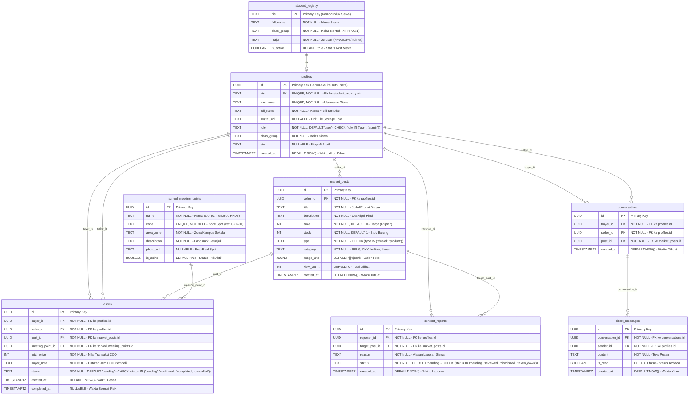

# 08. PHYSICAL DATA MODEL (PDM)

**Dokumen**: Bab III - Bagian 3.7.2  
**Proyek**: Snapan Market Mobile (sNaps) - SMKN 8 Semarang  
**Target DBMS**: PostgreSQL 15+ (Supabase BaaS) & Kompatibilitas Relasional SQL  

---

## 1. Definisi & Konsep PDM
Physical Data Model (PDM) merupakan spesifikasi teknis implementasi database fisik pada media penyimpanan komputer. PDM memetakan entitas konseptual ke dalam tabel nyata, mendefinisikan tipe data kolom secara presisi, mengalokasikan *Primary Key* (PK), *Foreign Key* (FK), nilai *Default*, serta *Check Constraints*.

---

## 2. Diagram Struktur Fisik Tabel (PDM)

---

## 3. Matriks Padanan Tipe Data Fisik (PostgreSQL vs MySQL)

Untuk memenuhi kebutuhan kurikulum sekolah yang sering menstandarisasi sintaks basis data relasional ke MySQL, berikut tabel padanan implementasinya:

| Kolom Teknis | Implementasi Nyata (PostgreSQL Supabase) | Alternatif Padanan (MySQL 8.0+) | Keterangan Batasan Integritas |
|---|---|---|---|
| Kunci Unik ID | `UUID DEFAULT gen_random_uuid()` | `VARCHAR(36)` / `CHAR(36)` | Menggunakan UUID v4 untuk mencegah nomor ID mudah ditebak (*anti-ID enumeration*). |
| Nomor Induk Siswa | `TEXT` | `VARCHAR(20)` | Terikat constraint unik pada tabel registry siswa. |
| Kuantitas Stok | `INT CHECK (stock >= 0)` | `INT CHECK (stock >= 0)` | Mencegah nilai kuantitas negatif di database. |
| Status Pesanan | `TEXT CHECK (status IN (...))` | `ENUM('pending','confirmed','completed','cancelled')` | Membatasi status state machine pesanan secara ketat. |
| Gambar Galeri | `JSONB DEFAULT '[]'::jsonb` | `JSON` | Menyimpan array URL foto multi-slide produk. |
| Waktu Transaksi | `TIMESTAMPTZ DEFAULT NOW()` | `DATETIME DEFAULT CURRENT_TIMESTAMP` | Menyimpan timestamp presisi zona waktu Indonesia Barat (+07:00). |
