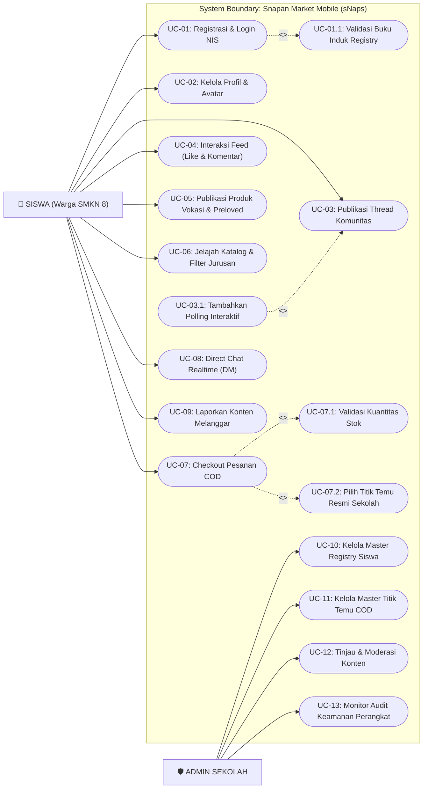

# 09. USE CASE DIAGRAM & SKENARIO SISTEM

**Dokumen**: Bab III - Bagian 3.5  
**Proyek**: Snapan Market Mobile (sNaps) - SMKN 8 Semarang  
**Fokus**: Pemodelan Fungsionalitas Sistem Berdasarkan Peran Aktor  

---

## 1. Definisi & Batasan Sistem
Use Case Diagram mendefinisikan interaksi fungsional antara aktor eksternal (**Siswa** dan **Admin Sekolah**) dengan kasus-kasus penggunaan (*use cases*) yang disediakan di dalam batasan sistem (*system boundary*) sNaps. Diagram ini juga mengilustrasikan dependensi berupa relasi `<<include>>` (proses mutlak yang wajib dipanggil) dan `<<extend>>` (proses bersyarat opsional).

---

## 2. Use Case Diagram sNaps

---

## 3. Identifikasi & Hak Akses Aktor

| Nama Aktor | Deskripsi Peran | Hak Akses Utama |
|---|---|---|
| **Siswa** | Warga belajar aktif SMKN 8 Semarang yang memiliki NIS sah. | Mengakses timeline, mengunggah karya, berbelanja karya sesama siswa, memesan COD di titik temu, mengirim chat, dan melaporkan postingan tidak pantas. |
| **Admin Sekolah** | Tim kesiswaan dan staf IT SMKN 8 Semarang. | Mengelola master data NIS, mengonfigurasi titik kumpul resmi sekolah, menindaklanjuti aduan laporan konten, serta memantau log perangkat mencurigakan. |

---

## 4. Spesifikasi Skenario Use Case Kunci

### 4.1 Skenario UC-01: Registrasi & Login NIS
- **Aktor**: Siswa
- **Tujuan**: Membuka akses aplikasi sNaps secara terverifikasi.
- **Pre-Condition**: Siswa memiliki NIS yang terdaftar di SMKN 8 Semarang.
- **Alur Utama (Main Flow)**:
  1. Siswa membuka form registrasi / login dan memasukkan NIS serta password.
  2. Sistem menjalankan `<<include>>` validasi ke `student_registry`.
  3. Jika valid, sistem mengecek batas perangkat (*device limit*).
  4. Sistem mengikat identifier perangkat (*bind device*) dan menerbitkan token sesi JWT.
  5. Siswa dialihkan ke halaman Beranda.
- **Alur Alternatif (Exception Flow)**:
  - Jika NIS tidak terdaftar di buku induk sekolah, sistem menolak autentikasi dan memunculkan notifikasi: *"NIS tidak terdaftar sebagai siswa aktif SMKN 8 Semarang."*

### 4.2 Skenario UC-07: Checkout Pesanan COD Titik Temu Sekolah
- **Aktor**: Siswa Pembeli
- **Tujuan**: Melakukan pemesanan barang karya vokasi dengan kesepakatan titik temu COD di area sekolah.
- **Pre-Condition**: Siswa login terverifikasi dan membuka halaman detail produk dengan stok $> 0$.
- **Alur Utama (Main Flow)**:
  1. Pembeli menekan tombol *"Beli Sekarang"*.
  2. Sistem membuka lembar checkout dan menjalankan `<<include>>` pemilihan titik temu resmi sekolah (`school_meeting_points`).
  3. Pembeli memilih salah satu spot (contoh: *Gazebo Depan PPLG*) dan menuliskan catatan waktu pertemuan (contoh: *Jam istirahat ke-1*).
  4. Pembeli menekan *"Konfirmasi Pesanan"*.
  5. Sistem menjalankan `<<include>>` validasi kuantitas stok atomik di database.
  6. Sistem menerbitkan pesanan baru di tabel `orders` dengan status `pending` dan memotong stok.
  7. Sistem mengirimkan push notifikasi ke penjual dan menampilkan modal sukses ke pembeli.
- **Alur Alternatif (Exception Flow)**:
  - Jika saat verifikasi akhir kuantitas stok bernilai 0 (telah dibeli siswa lain), sistem membatalkan pesanan dan menampilkan pesan: *"Mohon maaf, stok produk baru saja habis."*
