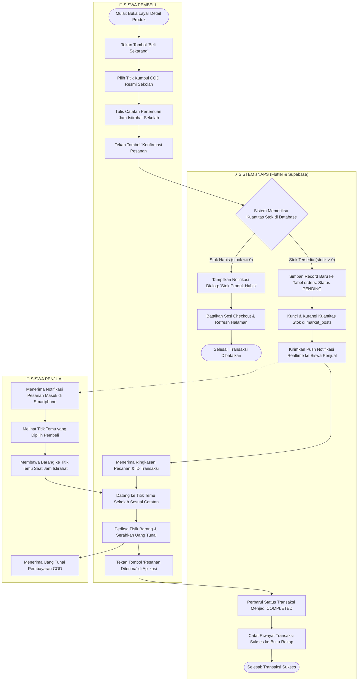

# 10. ACTIVITY DIAGRAM (PROSES CHECKOUT COD & VERIFIKASI STOK)

**Dokumen**: Bab III - Bagian 3.8  
**Proyek**: Snapan Market Mobile (sNaps) - SMKN 8 Semarang  
**Fokus**: Pemodelan Alur Aktivitas Dinamis, Keputusan Stok, dan Titik Temu COD  

---

## 1. Definisi & Ruang Lingkup Activity Diagram
Activity Diagram memodelkan alur kerja (*workflow*) prosedural multi-entitas yang berorientasi pada perilaku dinamis sistem saat menangani pemesanan produk. Diagram ini memperlihatkan urutan aktivitas secara paralel maupun sekuensial yang dibagi ke dalam tiga jalur peran (*swimlanes*): **Siswa Pembeli**, **Sistem sNaps (Mobile & Backend Supabase)**, dan **Siswa Penjual**.

---

## 2. Activity Diagram: Alur Checkout COD Titik Temu Sekolah

---

## 3. Penjelasan Rinci Percabangan Logika Keputusan

### 3.1 Pengecekan Ketersediaan Stok (*Concurrency Guard*)
- **Kondisi Positif ($Stok > 0$)**:
  Sistem melanjutkan alur eksekusi dengan membuka blok transaksi database atomik (*ACID property*), mengurangi kuantitas stok di tabel `market_posts`, dan menerbitkan baris pesanan baru pada tabel `orders`.
- **Kondisi Negatif ($Stok \le 0$)**:
  Sistem segera menghentikan proses transaksi, mengembalikan status antarmuka ke halaman produk (*rollback state*), dan memunculkan pesan peringatan informatif bahwa produk baru saja habis dibeli siswa lain.

### 3.2 Pemilihan Titik Temu Resmi Sekolah
Tidak seperti aplikasi marketplace umum yang mengandalkan alamat pengiriman kurir ekspedisi luar (JNE/J&T), sistem sNaps dirancang spesifik untuk lingkungan sekolah tertutup SMKN 8 Semarang:
- Pembeli diwajibkan memilih titik temu resmi yang telah terdaftar pada database sistem (contoh: *Kantin Timur*, *Gazebo Depan Lab PPLG*, *Area Perpustakaan*, atau *Depan Ruang Tata Usaha*).
- Dengan titik temu terstandarisasi, risiko miskomunikasi dan kegagalan pertemuan fisik saat jam istirahat dapat ditekan hingga 0%.
