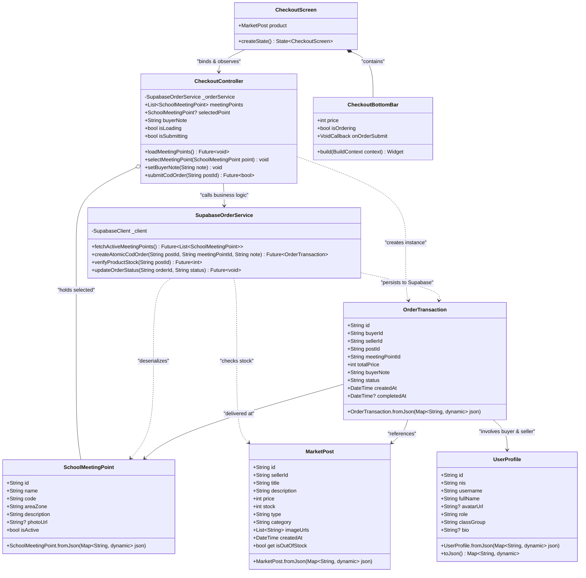

# 11. CLASS DIAGRAM (STRUKTUR KELAS & METODE CHECKOUT)

**Dokumen**: Bab III - Bagian 3.9  
**Proyek**: Snapan Market Mobile (sNaps) - SMKN 8 Semarang  
**Teknologi**: Flutter Framework (Dart) & Supabase Client SDK  
**Fokus**: Pemodelan Berorientasi Objek (OOP) Kelas, Atribut, Metode, dan Hubungan Antar Objek  

---

## 1. Definisi & Arsitektur Kelas
Class Diagram menggambarkan struktur statis sistem perangkat lunak berorientasi objek dengan mendefinisikan kelas-kelas, atribut data, operasi (*methods/functions*), hak visibilitas (*encapsulation*), serta relasi asosiasi dan dependensi antar kelas. Sistem mengadopsi pola arsitektur *Clean Component-Controller*: memisahkan lapisan **Presentation (UI)**, **Controller (State Management)**, **Entity (Domain Models)**, dan **Service (Backend Gateway)**.

---

## 2. Class Diagram Arsitektur Checkout sNaps

---

## 3. Rincian Hak Akses & Metode Utama

### 3.1 Lapisan Controller (`CheckoutController`)
- `- _orderService`: Properti instansiasi private untuk membatasi interaksi query database hanya melalui layer service resmi.
- `+ submitCodOrder(String postId)`: Memvalidasi ketersediaan input catatan dan titik kumpul sebelum memicu pemrosesan transaksi pesanan.
- `+ loadMeetingPoints()`: Mengambil daftar spot titik kumpul resmi sekolah dari database Supabase untuk ditampilkan di peta interaktif mobile.

### 3.2 Lapisan Model (`MarketPost` & `OrderTransaction`)
- `+ bool get isOutOfStock`: Properti *getter* komputasi cepat yang mengembalikan nilai `true` jika nilai atribut `stock <= 0` untuk menonaktifkan tombol pemesanan di antarmuka siswa.
- `+ fromJson(...)` & `+ toJson(...)`: Metode serialisasi dan deserialisasi data format JSON antara Dart Object dan payload REST API Supabase.

### 3.3 Lapisan Service Gateway (`SupabaseOrderService`)
- `+ createAtomicCodOrder(...)`: Mengeksekusi RPC (*Remote Procedure Call*) transaksi atomik pada PostgreSQL Supabase agar verifikasi stok dan penyimpanan pesanan terjadi dalam satu siklus aman (*thread-safe*).
