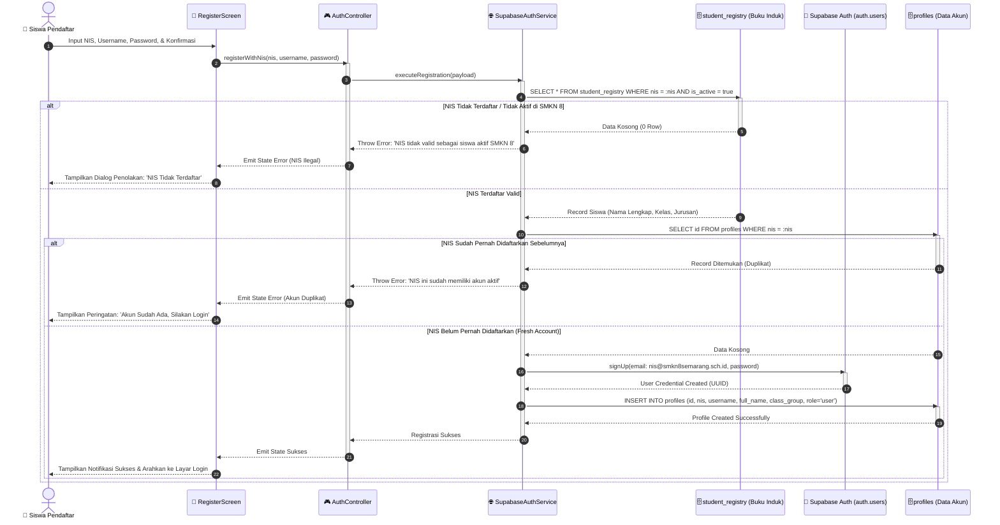
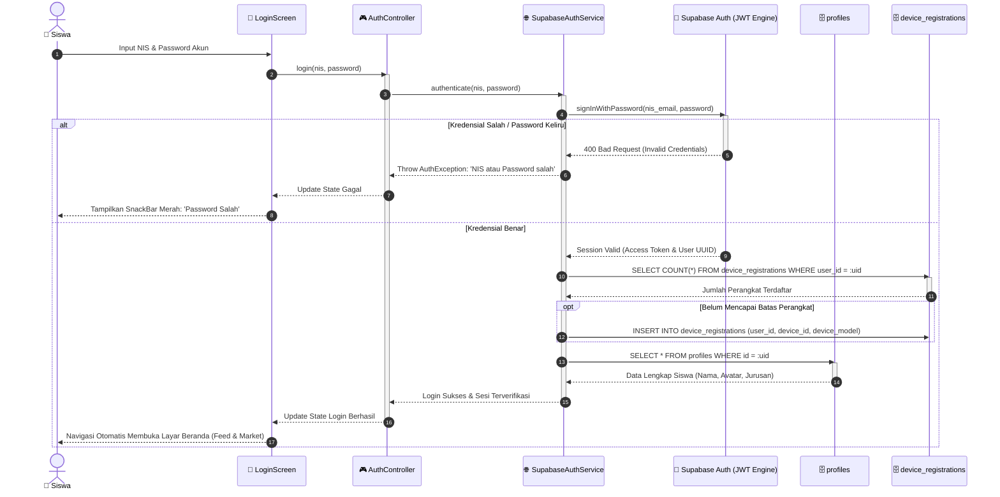

# 12. SEQUENCE DIAGRAM (PROSES REGISTRASI & LOGIN AKUN NIS)

**Dokumen**: Bab III - Bagian 3.10  
**Proyek**: Snapan Market Mobile (sNaps) - SMKN 8 Semarang  
**Teknologi**: Flutter Client, Supabase Auth Service, dan PostgreSQL  
**Fokus**: Pemodelan Alur Pesan Kronologis Antar Objek (*Temporal Message Sequences*)  

---

## 1. Definisi & Notasi Sequence Diagram
Sequence Diagram adalah jenis diagram interaksi UML yang memperlihatkan bagaimana objek-objek sistem berkolaborasi melalui pertukaran pesan (*message passing*) yang disusun dalam urutan waktu tertentu dari atas ke bawah. Notasi diagram mencakup:
- **Garis Kehidupan (*Lifeline*)**: Garis putus-putus vertikal yang merepresentasikan eksistensi objek sepanjang durasi interaksi.
- **Batang Aktivasi (*Activation Bar*)**: Kotak persegi panjang sempit pada garis hidup yang menandakan durasi saat objek aktif mengeksekusi operasi komputasi.
- **Fragmen Alternatif (`alt`)**: Kotak partisi bersyarat untuk menangani percabangan logika sukses vs kegagalan (*exception flow*).

---

## 2. Sequence Diagram 1: Proses Registrasi Akun Siswa (Verifikasi NIS)

Diagram ini memodelkan pendaftaran akun baru siswa dengan validasi silang ke master data buku induk sekolah:

---

## 3. Sequence Diagram 2: Proses Login Siswa & Device Binding

Diagram ini memodelkan interaksi saat siswa melakukan login dan sistem mengamankan sesi pada perangkat smartphone:

---

## 4. Evaluasi Alur Interaksi
1. **Pencegahan Akun Bodong (*Sybil Attack*)**:
   Melalui verifikasi di langkah (4-8) pada Diagram 1, pihak di luar SMKN 8 Semarang tidak akan pernah bisa membuat akun karena NIS mereka akan ditolak secara instan oleh tabel `student_registry`.
2. **Kepatuhan Satu Siswa Satu Identitas**:
   Pengecekan duplikasi pada langkah (10-15) memastikan bahwa siswa tidak dapat membuat banyak akun menggunakan satu nomor induk yang sama.
3. **Keamanan Sesi Perangkat (*Device Security*)**:
   Melalui pencatatan `device_registrations`, sistem dapat mendeteksi jika suatu akun diakses secara tidak wajar dari perangkat yang tidak dikenali.
