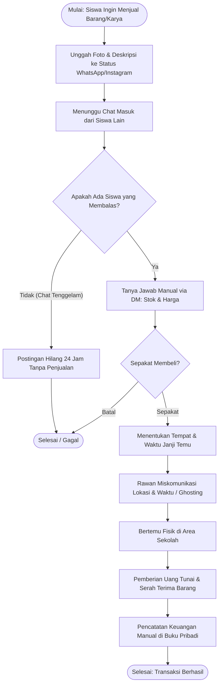
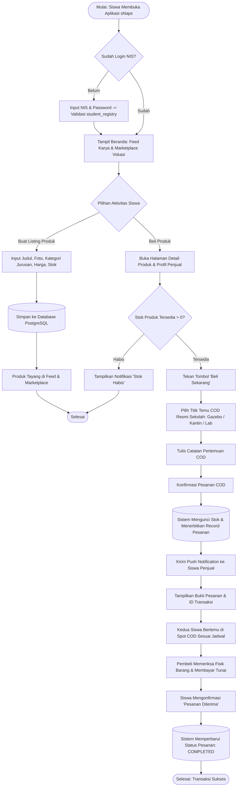
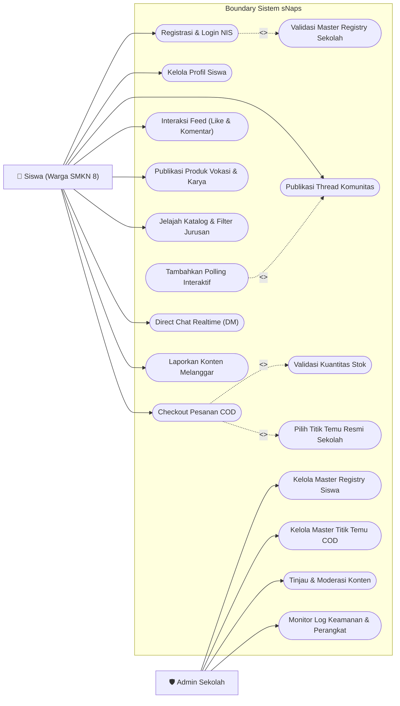
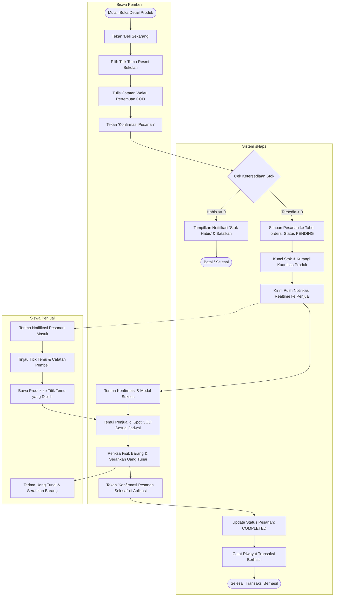
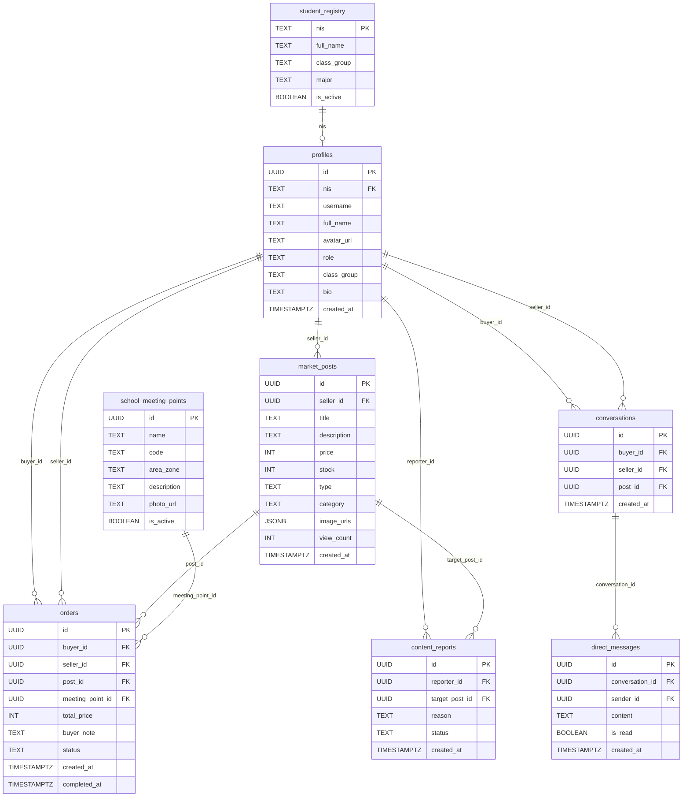
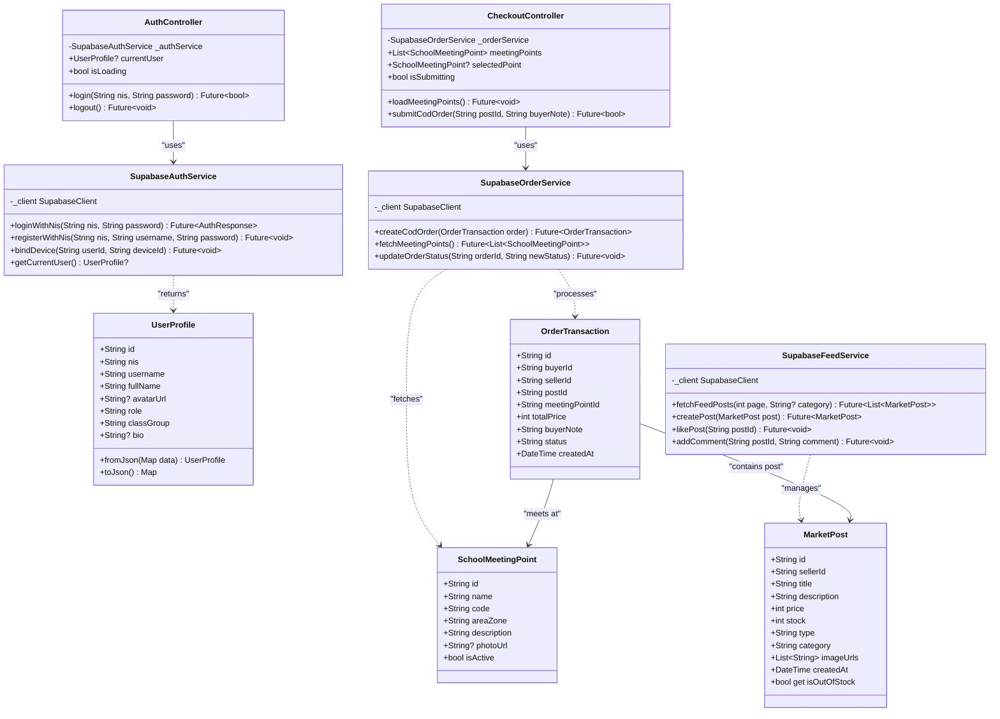
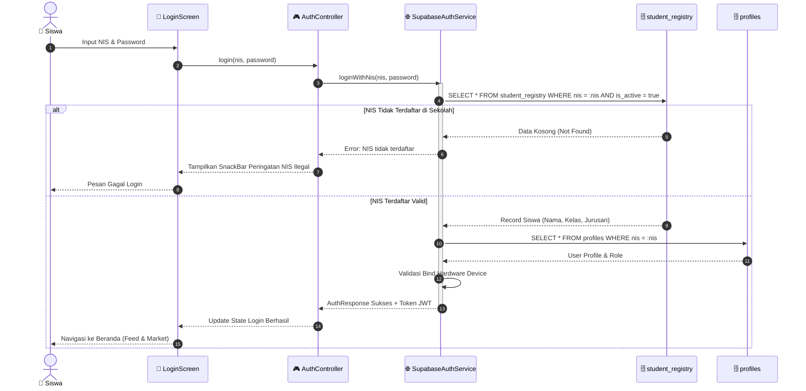
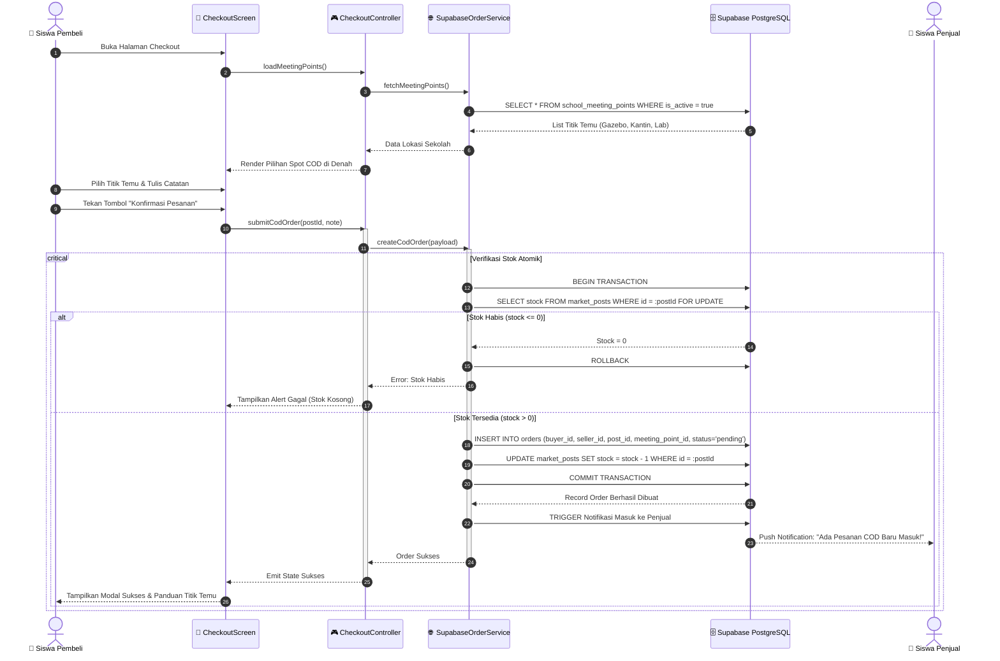

# BAB III: PERANCANGAN ARSITEKTUR SISTEM

**Judul Proyek**: Pengembangan Aplikasi Snapan Market Mobile (sNaps) Berbasis Android Sebagai Platform Komunitas dan Marketplace Vokasi di Lingkungan SMKN 8 Semarang  
**Program Keahlian**: Pengembangan Perangkat Lunak dan Gim (PPLG) - SMKN 8 Semarang  

---

## 3.1 Pelaksanaan dan Hasil Riset

### 3.1.1 Pelaksanaan Riset Lapangan
Riset perancangan sistem dilaksanakan di lingkungan kampus SMKN 8 Semarang dengan melibatkan siswa dari berbagai program keahlian (PPLG, DKV, Kuliner, dan Otomotif) melalui metode wawancara mendalam (*in-depth interview*) serta observasi langsung terhadap dinamika komunikasi siswa di grup chat WhatsApp sekolah.

### 3.1.2 Hasil dan Analisis Kebutuhan
Dari pelaksanaan riset tersebut, diperoleh kesimpulan dan analisis kebutuhan sebagai berikut:
1. **Kejenuhan dan Banjir Informasi pada Grup WhatsApp**: Siswa merasa promosi karya dan penawaran barang preloved di grup kelas atau grup angkatan sangat cepat tenggelam oleh tumpukan chat lainnya sehingga tidak efisien.
2. **Kebutuhan Wadah Unjuk Karya Jurusan**: Siswa PPLG membutuhkan media untuk mendistribusikan aplikasi/game, siswa DKV membutuhkan tempat memasarkan merchandise dan portofolio, dan siswa Kuliner memerlukan media pemesanan makanan ringan siap antar saat jam istirahat sekolah.
3. **Pentingnya Keamanan Ekosistem Berbasis NIS**: Siswa menginginkan aplikasi yang tertutup khusus warga sekolah, di mana login diwajibkan menggunakan Nomor Induk Siswa (NIS) untuk mencegah akun palsu atau penipuan dari luar sekolah.
4. **Preferensi Metode Pembayaran COD di Spot Sekolah**: Siswa menghendaki transaksi tanpa biaya admin transfer bank dengan metode pembayaran tunai saat bertemu langsung (*Cash on Delivery*) di titik-titik kumpul resmi sekolah.

---

## 3.2 Diagram Flowchart Sistem

### 3.2.1 Diagram Flowchart Alur Manual (Konvensional)
Diagram berikut menggambarkan alur jual-beli antar siswa sebelum adanya sistem aplikasi sNaps:



### 3.2.2 Diagram Flowchart Alur Sistem Digital (sNaps)
Diagram berikut menggambarkan alur terotomatisasi transaksi C2C dan interaksi komunitas pada aplikasi sNaps:



---

## 3.3 Diagram Konteks (Context Diagram)

Diagram Konteks memposisikan sistem sNaps pada Level 0 Global dengan batasan entitas luar **Siswa** dan **Admin Sekolah**:

```mermaid
flowchart LR
    subgraph SiswaEntity["Entitas Luar: Siswa"]
        Siswa["👤 SISWA (Warga SMKN 8)"]
    end

    subgraph CoreSystem["Sistem Utama"]
        App(("0.0<br/>SISTEM APLIKASI<br/>SNAPAN MARKET MOBILE<br/>(sNAPS)"))
    end

    subgraph AdminEntity["Entitas Luar: Admin"]
        Admin["🛡️ ADMIN SEKOLAH"]
    end

    %% Siswa -> Sistem
    Siswa -->|1. Kredensial Login NIS & Registrasi Perangkat| App
    Siswa -->|2. Data Postingan Thread & Produk Vokasi| App
    Siswa -->|3. Data Pesanan COD & Pilihan Titik Temu| App
    Siswa -->|4. Pesan Chat Realtime| App
    Siswa -->|5. Laporan Pelanggaran Konten| App

    %% Sistem -> Siswa
    App -->|a. Akses Beranda & Profil Siswa| Siswa
    App -->|b. Tampilan Feed & Katalog Produk Vokasi| Siswa
    App -->|c. Notifikasi Status Pesanan & Lokasi COD| Siswa
    App -->|d. Pesan Chat Masuk Realtime| Siswa

    %% Admin -> Sistem
    Admin -->|1. Master Data Registry Siswa (NIS & Kelas)| App
    Admin -->|2. Master Titik Temu COD Sekolah| App
    Admin -->|3. Tindakan Moderasi (Banned Akun/Take Down Post)| App

    %% Sistem -> Admin
    App -->|a. Notifikasi Laporan Konten Siswa| Admin
    App -->|b. Log Keamanan & Registrasi Hardware| Admin
    App -->|c. Rekapitulasi Data Siswa & Transaksi Sekolah| Admin
```

---

## 3.4 Data Flow Diagram (DFD)

### 3.4.1 DFD Level 0
Menguraikan sistem utama menjadi lima sub-proses fungsional terintegrasi dengan tabel penyimpanan:

```mermaid
flowchart TD
    Siswa["👤 Siswa"]
    Admin["🛡️ Admin Sekolah"]

    P1(("1.0<br/>Autentikasi &<br/>Profil Siswa"))
    P2(("2.0<br/>Feed Komunitas &<br/>Diskusi Vokasi"))
    P3(("3.0<br/>Manajemen Produk &<br/>Katalog Karya"))
    P4(("4.0<br/>Transaksi COD &<br/>Titik Temu"))
    P5(("5.0<br/>Moderasi Konten &<br/>Master Registry"))

    D1[("D1: student_registry")]
    D2[("D2: profiles")]
    D3[("D3: market_posts")]
    D4[("D4: school_meeting_points")]
    D5[("D5: orders")]
    D6[("D6: content_reports")]

    Siswa -->|NIS & Password| P1
    D1 -->|Verifikasi Validitas NIS| P1
    P1 -->|Simpan Profil| D2
    P1 -->|Session Aktif| Siswa

    Siswa -->|Unggah Thread / Like / Komen| P2
    P2 -->|Simpan Interaksi| D3
    D3 -->|Ambil Data Feed| P2
    P2 -->|Timeline Beranda| Siswa

    Siswa -->|Unggah Produk Vokasi| P3
    P3 -->|Simpan Produk & Stok| D3
    D3 -->|Katalog Produk| P3
    P3 -->|Tampilkan Produk Jurusan| Siswa

    Siswa -->|Pilih Barang & Titik Temu| P4
    D4 -->|Data Titik Temu Sekolah| P4
    P4 -->|Validasi Stok & Buat Order| D5
    P4 -->|Update Stok Terkunci| D3
    D5 -->|Status Pesanan| P4
    P4 -->|Notifikasi Pesanan & Bukti COD| Siswa

    Siswa -->|Laporkan Konten| P5
    P5 -->|Simpan Laporan| D6
    Admin -->|Master Siswa (NIS/Kelas)| P5
    P5 -->|Update Registry| D1
    Admin -->|Kelola Spot COD| P5
    P5 -->|Update Titik Temu| D4
    D6 -->|Daftar Laporan| P5
    P5 -->|Hasil Moderasi| Admin
```

### 3.4.2 DFD Level 1 (Fokus: Proses 4.0 Transaksi COD)
Menguraikan rincian sub-proses transaksi pemesanan barang hingga serah terima di sekolah:

```mermaid
flowchart TD
    Pembeli["👤 Siswa Pembeli"]
    Penjual["👤 Siswa Penjual"]

    P41(("4.1<br/>Validasi Kuantitas &<br/>Ketersediaan Stok"))
    P42(("4.2<br/>Pemilihan Titik Temu<br/>Resmi Sekolah"))
    P43(("4.3<br/>Penerbitan Pesanan &<br/>Notifikasi Realtime"))
    P44(("4.4<br/>Verifikasi Fisik COD &<br/>Penyelesaian Pesanan"))

    D3[("D3: market_posts")]
    D4[("D4: school_meeting_points")]
    D5[("D5: orders")]

    Pembeli -->|Pilih Item & Kuantitas| P41
    D3 -->|Cek Kuantitas Stok| P41
    P41 -->|Stok Valid| P42

    D4 -->|Daftar Titik Temu Aktif| P42
    Pembeli -->|Pilih Titik Kumpul & Catatan Jam| P42
    P42 -->|Data Lengkap Checkout| P43

    P43 -->|Simpan Pesanan (Status: PENDING)| D5
    P43 -->|Kurangi Kuantitas Stok| D3
    P43 -->|Push Notifikasi Pesanan Baru| Penjual
    P43 -->|Ringkasan Pesanan Digital| Pembeli

    Pembeli -->|Konfirmasi Terima Barang| P44
    Penjual -->|Konfirmasi Penyerahan Fisik & Uang| P44
    P44 -->|Update Status (COMPLETED)| D5
```

---

## 3.5 Use Case Diagram



### Skenario Use Case Utama (UC-07: Checkout Pesanan COD Titik Temu)
- **Aktor Utama**: Siswa Pembeli
- **Aktor Sekunder**: Siswa Penjual, Database Server
- **Kondisi Awal (Pre-condition)**: Pembeli terautentikasi NIS dan stok produk $> 0$.
- **Kondisi Akhir (Post-condition)**: Record `orders` tercipta dengan status `pending`, stok terpotong, dan notifikasi terkirim ke penjual.
- **Alur Normal**: Pembeli memilih barang -> Memilih titik temu resmi sekolah -> Mengisi catatan waktu COD -> Menekan konfirmasi pesanan -> Sistem mengunci stok dan menerbitkan pesanan -> Penjual menerima notifikasi realtime.
- **Alur Alternatif**: Jika stok habis saat divalidasi, sistem membatalkan proses dan memunculkan dialog stok telah habis.

---

## 3.6 Activity Diagram (Checkout COD Titik Temu)



---

## 3.7 Perancangan Basis Data (ERD, CDM, PDM)

### 3.7.1 Conceptual Data Model (CDM)
Struktur konseptual data logis mendefinisikan hubungan bisnis antara entitas utama:
- `student_registry`: Master buku induk sekolah (NIS, Nama, Kelas, Jurusan).
- `profiles`: Akun aktif pengguna aplikasi sNaps.
- `market_posts`: Listing produk wirausaha dan thread forum diskusi.
- `school_meeting_points`: Daftar lokasi titik temu fisik di sekolah.
- `orders`: Data pesanan COD antar siswa.
- `conversations` & `direct_messages`: Data obrolan privat antar pengguna.
- `content_reports`: Data pelaporan konten melanggar etika sekolah.

### 3.7.2 Physical Data Model (PDM)
Struktur fisik tabel diimplementasikan pada database PostgreSQL (Supabase):



---

## 3.8 Class Diagram



---

## 3.9 Sequence Diagram

### 3.9.1 Sequence Diagram: Autentikasi NIS & Device Binding



### 3.9.2 Sequence Diagram: Checkout Pesanan COD Titik Temu Sekolah


