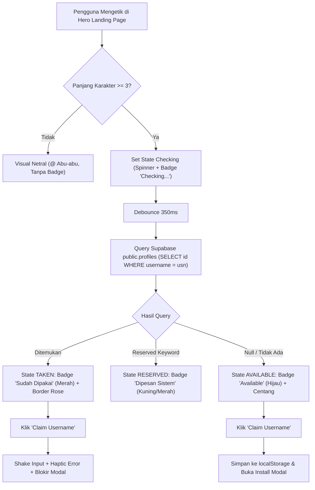

# [SNAPS-73] feat(landing-page): integrasi realtime check nickname ke backend Supabase

> **Ticket Metadata**:
> - **Plane ID**: `4bd2658f-19e0-4059-929c-31783de5b1ee`
> - **Sequence**: SNAPS-73
> - **Priority**: HIGH
> - **State Group**: completed / done (State: Done)
> - **Domain**: `landing_page / auth / profile / check_nickname / supabase`

---

## 1. Problem Statement & User Context
- **Deskripsi Masalah User**:
> *"Kita fokus ke landing page ya, ini kan belum kehubung dengan backend. Ada ga fitur dari landing page yang bisa kita integrasiin ke backend. Scope gua si hanya check nickname aja ya."*

- **Akar Masalah Teknis (Current State Analysis)**:
  1. **Validasi Semu / Pure Client-Side Mock**:
     Pada landing page web/PWA ([`src/ui/components/pwa/usePwaLandingEffects.ts`](file:///home/rayhan/Windows-D/project/snapan-market-mobile/src/ui/components/pwa/usePwaLandingEffects.ts#L130-L170)), kolom klaim username `@input` saat ini hanya memeriksa panjang karakter `clean.length >= 3`. Jika syarat $\ge 3$ terpenuhi, UI langsung menyalakan badge hijau `"Available"` dan tanda centang secara instan.
  2. **Tanpa Pengecekan Database `public.profiles`**:
     Jika pengunjung mengetik username yang sudah resmi dimiliki siswa lain (misal: `admin`, `radityarayhannnn`, atau akun siswa yang sudah terdaftar), landing page tetap menampilkan badge `"Available"`. Ini menciptakan ilusi palsu kepada pengunjung sebelum mereka mengunduh aplikasi atau melakukan registrasi.
  3. **Belum Ada Debounce & Network Query**:
     Sistem input belum memiliki mekanisme debounce (300ms–400ms) untuk menanyakan ketersediaan username ke endpoint Supabase REST API `public.profiles`.
  4. **Keamanan & Reserved Keyword Belum Dibatasi**:
     Kata kunci sistem seperti `admin`, `official`, `support`, `snapan`, `moderator` belum dicegah di layer pre-check.

---

## 2. Target File Scope (Interface-First Coupling)
> Rujukan arsitektur berbasis React PWA Web + Supabase:

| Peran File | Path File di Repositori | Keterangan Peran |
| :--- | :--- | :--- |
| **Profile API Service** | [`src/services/api/profileService.ts`](file:///home/rayhan/Windows-D/project/snapan-market-mobile/src/services/api/profileService.ts) | Menambahkan service helper `checkUsernameAvailability(username)` dengan sanitasi, reserved check, dan query case-insensitive ke `public.profiles` |
| **Landing Effects Orchestrator** | [`src/ui/components/pwa/usePwaLandingEffects.ts`](file:///home/rayhan/Windows-D/project/snapan-market-mobile/src/ui/components/pwa/usePwaLandingEffects.ts) | Menghubungkan input event dengan debounce query, mengelola state visual: `idle` $\to$ `checking` $\to$ `available` / `taken` |
| **Landing Stylesheet** | [`src/ui/components/pwa/pwaLanding.css`](file:///home/rayhan/Windows-D/project/snapan-market-mobile/src/ui/components/pwa/pwaLanding.css) | Menambahkan kelas gaya badge `.username-available-tag.is-taken` (rose/merah) & `.username-available-tag.is-checking` (blue/spinner) |
| **PWA Landing Page Entry** | [`src/ui/components/pwa/PwaLandingPage.tsx`](file:///home/rayhan/Windows-D/project/snapan-market-mobile/src/ui/components/pwa/PwaLandingPage.tsx) | Container utama yang me-render layout landing page desktop & mobile |
| **Reserved Bridge Hook (Opsional)** | [`src/ui/hooks/useAuth.ts`](file:///home/rayhan/Windows-D/project/snapan-market-mobile/src/ui/hooks/useAuth.ts) | Membaca `localStorage.getItem('snapan_reserved_username')` saat user beralih dari landing page ke alur registrasi web |

---

## 3. Step-by-Step Technical Approach (Untuk AI Agent Eksekutor)

### Langkah 1: Buat Fungsi Pengecekan di `profileService.ts`
1. Buka [`src/services/api/profileService.ts`](file:///home/rayhan/Windows-D/project/snapan-market-mobile/src/services/api/profileService.ts).
2. Buat tipe hasil ketersediaan:
   ```typescript
   export type UsernameCheckResult = {
     available: boolean;
     cleanUsername: string;
     reason?: 'too_short' | 'invalid_chars' | 'reserved' | 'taken';
     message?: string;
   };
   ```
3. Implementasikan fungsi `checkUsernameAvailability(rawUsername: string)`:
   - Sanitasi string: buang prefix `@`, konversi ke `toLowerCase()`, dan trim whitespace.
   - Validasi format regex `^[a-z0-9_.]{3,20}$`.
   - Blacklist / reserved keywords:
     `['admin', 'administrator', 'root', 'snapan', 'official', 'support', 'help', 'system', 'moderator', 'smkn8', 'smkn8semarang', 'bot']`.
   - Query Supabase:
     ```typescript
     const { data, error } = await supabase
       .from('profiles')
       .select('id, username')
       .ilike('username', cleanUsername)
       .maybeSingle();
     ```
     *(Catatan: RLS `public.profiles` mengizinkan SELECT untuk publik `using (true)`, sehingga anon user di landing page aman melakukan query tanpa harus login).*
   - Jika `data` ditemukan, kembalikan `{ available: false, reason: 'taken', message: 'Username sudah digunakan' }`.
   - Jika `data === null`, kembalikan `{ available: true, cleanUsername }`.

### Langkah 2: Update CSS Badge State di `pwaLanding.css`
Tambahkan dukungan styling state untuk badge ketersediaan:
1. State **Taken / Sudah Dipakai**:
   ```css
   .username-available-tag.is-taken {
     display: inline-flex !important;
     background: #fff1f2 !important;
     color: #e11d48 !important;
     border: 1px solid #fecdd3 !important;
     animation: popAvailableBadge 0.2s cubic-bezier(0.16, 1, 0.3, 1) both !important;
   }
   ```
2. State **Checking / Sedang Mengecek**:
   ```css
   .username-available-tag.is-checking {
     display: inline-flex !important;
     background: #eff6ff !important;
     color: #2563eb !important;
     border: 1px solid #bfdbfe !important;
     animation: popAvailableBadge 0.2s cubic-bezier(0.16, 1, 0.3, 1) both !important;
   }
   ```
3. Capsule border styling saat Taken (`#e11d48`) dan Checking (`#3b82f6`).

### Langkah 3: Integrasi Debounce & Visual Feedback di `usePwaLandingEffects.ts`
1. Di dalam loop `inputs.forEach((input) => ...)`:
   - Tambahkan state timer `let checkDebounceTimer: ReturnType<typeof setTimeout> | null = null;`.
   - Tambahkan flag `let latestCheckedUsername = '';`.
   - Tambahkan helper status render:
     - **Idle / Kosong**: Status icon default `@` abu-abu, sembunyikan badge.
     - **Checking**: Status icon loader memutar / titik biru, badge teks `"Checking..."` (`.is-checking`).
     - **Available**: Status icon centang hijau, badge teks `"Available"` (`.is-available`), capsule border `#10b981`.
     - **Taken**: Status icon silang merah / tanda seru, badge teks `"Sudah Dipakai"` (`.is-taken`), capsule border `#e11d48`.
2. Pada event `handleInput`:
   - Batalkan timer debounce lama (`if (checkDebounceTimer) clearTimeout(checkDebounceTimer)`).
   - Jika `clean.length < 3`, reset ke visual state normal.
   - Jika `clean.length >= 3`, pasang visual `checking` dan jadwalkan query ke `checkUsernameAvailability` dengan jeda **350ms**.
3. Di dalam callback debounce:
   - Panggil `await checkUsernameAvailability(clean)`.
   - Cocokkan kembali apakah input saat ini masih sama dengan kata yang dicek (cegah race condition akibat ketikan cepat).
   - Render hasil `available` atau `taken`.

### Langkah 4: Validasi saat Tombol "Claim / Pasang" Diklik
1. Pada blok `handleGlobalClick` (bagian penanganan tombol Claim / Daftar / Pasang):
   - Ambil nilai username terakhir.
   - Jika status username adalah `taken` atau belum `available`:
     - Cegah navigasi (`e.preventDefault()`).
     - Berikan haptic feedback error (`triggerHaptic('error')`).
     - Jalankan animasi shake pada capsule input.
     - Tampilkan alert popover / warning badge: *"Username sudah terdaftar! Pilih username lain."*
   - Jika status `available`:
     - Simpan username ke `localStorage.setItem('snapan_reserved_username', val)`.
     - Lanjutkan pembukaan `CustomPwaInstallModal` atau redirect web.

---

## 4. Rincian Desain & Edge Cases



### Edge Cases yang Diantisipasi:
1. **Network Offline / Timeout Supabase**:
   Jika request gagal karena koneksi internet lambat atau offline, sistem memberikan fallback graceful (jangan biarkan app crash; tampilkan icon peringatan atau coba ulang).
2. **Race Condition Ketikan Cepat**:
   Jika user mengetik `andi` lalu cepat-cepat mengetik `andika`, respon query untuk `andi` tidak boleh menimpa visual state `andika`. Mekanisme `latestQueryId` atau pencocokan string aktif wajib dipasang.
3. **Case Insensitive**:
   Pengecekan menggunakan `.ilike('username', cleanUsername)` sehingga `Raditya` dan `raditya` dianggap identik dan tidak bisa diduplikasi.

---

## 5. Definition of Done (DoD)
- [x] Fungsi `checkUsernameAvailability` terpasang di [`src/services/api/profileService.ts`](file:///home/rayhan/Windows-D/project/snapan-market-mobile/src/services/api/profileService.ts) dan memvalidasi `public.profiles`.
- [x] Input username pada landing page memiliki debouncing 350ms dan indikator loading (*checking state*).
- [x] Username yang sudah ada di Supabase menampilkan indikator merah `"Sudah Dipakai"` dan capsule border rose.
- [x] Username yang tersedia menampilkan indikator hijau `"Available"` dan border emerald.
- [x] Tombol CTA Claim/Pasang memblokir proses jika username berstatus taken, dan menyimpan ke `localStorage` jika valid.
- [x] Tidak ada breaking changes pada responsive layout mobile maupun desktop.
